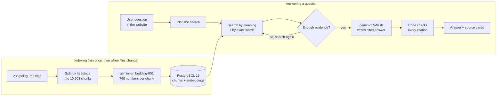

# ePolicies AI Assistant — Presentation Notes (10-minute meeting)

Everything below is taken from the project code, README, configuration and the real runs on the
company laptop. Where a number does not exist yet, it says **"Not available in the project"** and
suggests what to measure.

---

## 1. Project summary (2–3 sentences)

The ePolicies AI Assistant lets anyone ask a question about our 235 ePolicies documents in plain
English and get an answer written **only from those documents**, with the exact policy passages it used
shown as clickable sources. It saves people from searching through long policy pages by hand, and
because every answer is checked against the source text and the assistant says "not found" instead of
guessing, the answers can be trusted and verified.

---

## 2. Slide-by-slide outline, with speaker notes

### Slide 1 — Title
- **ePolicies AI Assistant**: ask policy questions, get cited answers
- Built on our own 235 ePolicies Markdown files
- Runs on the company laptop with Google Gemini through our Vertex AI project
- Presenter: <your name> · <date>

**Speaker notes:** "Today I'll show a tool I built that answers questions about our ePolicies. It reads
our own policy files, answers in plain English, and shows exactly which policy and section each answer
came from. I'll explain how it works, show a live demo, and share results and next steps."

---

### Slide 2 — Problem / background
- We have **235 policy documents** (Medicare HRP claim processing, coding, COB, DME, and more)
- Finding one rule means opening several long documents and reading many sections
- Some topics appear in more than one document (for example, COB has a Policy page and a Medicare HRP Claim Processing page)
- A normal chatbot is risky here: it can make up answers that sound right

**Speaker notes:** "Our policies are spread across 235 documents. To answer one question, people often
open several pages and scroll through long sections. A general AI chatbot isn't safe for this, because
it can confidently invent an answer. We need something that answers only from our documents and proves
where the answer came from."

---

### Slide 3 — Goal of the project
- Answer policy questions **only from our own documents**, no internet search
- Show **sources** for every answer: document name, section and the exact passage
- Say clearly **"not found in the documents"** instead of guessing
- Keep it easy to update when the policy files change

**Speaker notes:** "The goal was a trustworthy assistant. Three rules: answer only from our files, always
show the source, and admit when the files don't cover something. It also had to be easy to refresh when
the scraper updates the policies."

---

### Slide 4 — How it works (step by step)
1. **Read and split:** each policy file is split into small sections ("chunks") by its headings; tables stay together
2. **Turn text into numbers:** Google's embedding model turns each chunk into 768 numbers that capture its meaning, stored in a PostgreSQL database
3. **Search two ways:** for a question, it finds chunks that match by **meaning** and by **exact words or codes**, then combines both rankings
4. **Check, answer, verify:** Gemini checks whether the evidence is enough (searching again if not), writes the answer with source markers, and the code checks every citation

**Speaker notes:** "Four steps. First, each document is cut into small sections at its headings. Second,
each section is turned into a list of numbers that represents its meaning. That's called an *embedding*:
think of it as coordinates where similar ideas sit close together. Third, when someone asks a question,
we search by meaning and also by exact words, like a policy code, and merge the two lists. Fourth, the AI
checks whether it found enough. If not, it searches again with new queries. Then it writes an answer that
cites the sources, and the code double-checks that each cited passage really contains what the answer
says."

---

### Slide 5 — Architecture / flow diagram
- Three parts: **website** (what users see), **backend API** (the logic), **database** (the stored policies)
- Google **Vertex AI** provides two models: one for embeddings, one for writing answers
- Policy files are read only; they are never changed
- Everything except the Gemini calls runs on the laptop



ASCII version (if Mermaid does not render):

```
 INDEXING
 235 .md files -> split by headings -> gemini-embedding-001 -> PostgreSQL (10,503 chunks)

 ANSWERING
 Question -> plan -> search (meaning + exact words) <-> PostgreSQL
                         |
                 enough evidence? --no--> search again (max 3 rounds)
                         | yes
                 gemini-2.5-flash writes answer with [S1] [S2] markers
                         |
                 code verifies citations -> answer + clickable sources
```

**Speaker notes:** "On the left is the indexing part, which runs once and again whenever files change:
files go in, get split, get turned into numbers, and are saved in a database. On the right is what
happens for each question: plan, search, check whether there's enough evidence, search again if
needed, write the answer, verify the citations. The search loop is limited to three rounds so it never
runs forever."

---

### Slide 6 — Tools and technologies, and why
- **Google Gemini through Vertex AI** (`gemini-embedding-001` for embeddings, `gemini-2.5-flash` for answers), project `hcb-dev-genai-tools`, signed in with the company `gcloud` login, no API key stored
- **PostgreSQL 16**: one database for documents, chunks, embeddings, history and chat logs; also does the keyword search
- **Python + FastAPI** (backend) and **Next.js + TypeScript** (website), the official Google Gen AI SDK
- **Hybrid search + Reciprocal Rank Fusion**: merges the meaning results and the keyword results into one ranking

**Speaker notes:** "Gemini comes through our company's Vertex AI project, so I log in with my company
account and no secret key sits in the code. Everything is stored in one PostgreSQL database. It also
does the keyword search, so we don't need a separate search engine. Python runs the logic and Next.js
is the website. The hybrid search matters because meaning search is good for 'what is the rule on
X', while keyword search catches exact codes and terms. Reciprocal Rank Fusion is just a simple formula
that combines the two ranked lists so items ranked well by both come first."

---

### Slide 7 — Demo plan
- Start the database, the backend and the website (3 commands)
- Show the **Knowledge base** page: 235 policies indexed
- Ask a real question in **Chat** and click a source chip to show the exact passage
- Ask something **not** in the policies to show it says "not found"

**Exact commands** (start before the meeting; each in its own terminal):

```powershell
& "C:\Program Files\PostgreSQL\16\bin\pg_ctl.exe" -D "$HOME\epolicies-pgdata" -o "-p 5433" -l "$HOME\epolicies-pgdata\log.txt" start
```
```powershell
cd $HOME\Downloads\epolicies-rag-main\epolicies-rag-main\backend
..\..\.venv\Scripts\Activate.ps1
uvicorn app.main:app --port 8000
```
```powershell
$env:Path += ";C:\Program Files\nodejs"
cd $HOME\Downloads\epolicies-rag-main\epolicies-rag-main\frontend
npm run dev
```

Then open **http://localhost:3000**.

**What to show:**
1. **Knowledge base** page: the list of policies with status "Indexed" and chunk counts.
2. **Chat:** *"What is the policy on coordination of benefits?"* Point at the sections in the answer
   (types of plans, COB benefit credit, order of benefit determination) and click **S1** to open the source card.
3. Turn on **Diagnostics**: show the search rounds and that the sources come from the COB documents.
4. **Not covered:** a question the policies don't answer (for example, office parking). Show that it says it
   could not find it, with no made-up answer.
5. **Backup:** if the website has a problem, run the same question in the terminal:
   `python -m app.cli ask "What is the policy on coordination of benefits?" --diagnostics`

**Speaker notes:** "I'll start with the knowledge base page so you can see all 235 policies are loaded.
Then I'll ask about coordination of benefits. Notice the small S1, S2 tags. Clicking one shows the exact
policy text the sentence came from. Finally I'll ask something that isn't in our policies, so you can
see it doesn't make things up." (Each answer takes about 20–40 seconds. Say this before you ask, so
the wait feels expected.)

---

### Slide 8 — Results (real numbers only)
- **235 / 235** policy files indexed, **0 failed** (`ingest` report)
- **10,503** chunks created; **9,321** embeddings generated, **1,182** reused (repeated text is embedded only once)
- Real COB question: answer built from **8 sources** across 2 COB documents, **all 8 citations verified**, 3 search rounds, 5 AI calls, about **39 seconds**
- **110 automated tests** pass on the development machine

**Not available in the project yet:**
- **Accuracy on real questions:** no evaluation set of real questions with known answers exists yet. The project has an evaluation tool (`python -m app.cli evaluate`) and a template, `backend/eval/epolicies_eval.template.jsonl`. Suggestion: write 20 real questions with the correct source file, then measure how often the right document is found (Recall@5) and how often the citations are correct.
- **Time saved:** not measured. Suggestion: time 5–10 colleagues answering the same questions manually vs. with the assistant.
- **Cost per question:** token counts are shown in Diagnostics, but no cost total has been calculated.

**Speaker notes:** "All 235 files were processed with zero failures, producing about ten and a half
thousand searchable sections. On a real coordination-of-benefits question, the answer pulled from eight
passages in two COB documents, and the code confirmed all eight citations. I don't have an accuracy
percentage on real questions yet. That's the next thing I want to measure, with a set of questions where
we already know the right answer."

---

### Slide 9 — Challenges and how I solved them
- **Gemini access:** a plain API key was rejected (401). The company provides Gemini through **Vertex AI**, so I added support for the `gcloud` login and the `hcb-dev-genai-tools` project
- **No pgvector on the laptop** (the add-on PostgreSQL normally needs for meaning search): I built a fallback that stores the embeddings in plain PostgreSQL and does the similarity maths in the app, about 2 ms per search for 10,503 chunks
- **Model availability:** `gemini-3.5-flash` was not enabled in our project (404). I switched to `gemini-2.5-flash`, which is a setting, not a code change
- **Answers cut off** ("malformed JSON"): I turned off the model's extra "thinking" and added an automatic retry, plus a plain-text fallback

**Speaker notes:** "A few real problems came up. First, the API key didn't work, because our company
uses Vertex AI, so I added that login method. Second, the laptop's PostgreSQL didn't have the vector
add-on, and installing it needs admin rights, so I wrote a fallback that's still fast: about two
milliseconds per search. Third, the newest Gemini model wasn't enabled in our project, so I used one
that is. Fourth, long answers were sometimes cut off, and I fixed that with a setting and an automatic
retry."

---

### Slide 10 — Limitations and next steps
- **Runs on one laptop:** the database must be started after each restart; no user login, so chat history is shared by anyone using that machine
- **Not yet measured:** accuracy on real questions and time saved (see Slide 8)
- **Broad questions** ("tell me all about COB") may be marked "insufficient evidence" because one answer can't cover dozens of pages; focused questions work better
- **Next:** build a 20-question test set, get approval for data use, ask IT for pgvector and a shared server with company sign-on (SSO)

**Speaker notes:** "It works today on my laptop, but it's not a shared service yet: there's no login,
and the database needs starting after a restart. Very broad questions can be flagged as incomplete,
because no single answer can summarise dozens of pages. Next I'd like to build a test set of real
questions to measure accuracy, confirm the data approval, and, if the team finds it useful, move it to
a shared server with company sign-on."

---

## 3. Simple explanations of technical terms

| Term | Simple meaning |
|---|---|
| **RAG** (Retrieval-Augmented Generation) | First find the relevant document passages, then let the AI write an answer using only those passages |
| **Chunk** | A small section of a policy document (cut at its headings), the unit the system searches |
| **Embedding** | A list of numbers (here 768) that represents what a piece of text means; similar meanings get similar numbers |
| **Vector / semantic search** | Searching by meaning (embeddings), so "reimbursement limit" can find "maximum payment" |
| **Keyword search** | Searching by the exact words or codes in the text |
| **Hybrid search** | Using both meaning search and keyword search together |
| **Reciprocal Rank Fusion (RRF)** | A simple formula that merges two ranked lists; items near the top of both lists win |
| **Agentic** | The AI takes steps by itself: checks whether it found enough and searches again if not (limited to 3 rounds) |
| **Citation verification** | Code that checks every [S1]-style marker points to a real retrieved passage that contains the claimed words and numbers |
| **Strict grounding** | If an answer has no verified source, it is hidden and replaced with "not found in the documents" |
| **Vertex AI** | Google Cloud's service for using Gemini under our company account and project |
| **PostgreSQL** | The database that stores the policy chunks, their embeddings and chat history |
| **pgvector** | An optional PostgreSQL add-on for fast meaning search (not installed on the laptop; the app uses its own fallback) |

---

## 4. Likely questions and short answers

1. **Does it use the internet or ChatGPT-style general knowledge?**
   No. It only searches our 235 policy files. The only outside connection is Google Gemini through our Vertex AI project, which receives the question and the matching policy passages. With strict grounding on, any answer without a verified source is blocked.

2. **What happens if the answer isn't in the policies?**
   It says it could not find the information in the indexed documents and shows no sources. In the project's tests (on sample documents), it tried extra searches first, then reported "not found" instead of guessing.

3. **How do we know the answer is correct?**
   Every sentence carries a source marker; clicking it shows the exact policy passage. The code also checks that each cited passage exists, was actually retrieved, and contains the claim's words and numbers. People should still check the source for important decisions.

4. **How accurate is it?**
   Not measured on real questions yet. The project has an evaluation tool; the next step is a 20-question set with known answers to measure how often the right document is found and the citations are correct.

5. **How long does an answer take?**
   About 39 seconds on the COB demo question (it searched 3 rounds and made 5 AI calls). Response time for other questions has not been measured; simple questions need fewer search rounds and AI calls.

6. **What happens when policies are updated?**
   Run `python -m app.cli ingest` again. Only new or changed files are processed, and unchanged text is not sent to Gemini again, so updates are quicker and cheaper.

7. **Is our data safe?**
   The policy files never leave the laptop except as passages sent to Gemini in our company Vertex AI project (`hcb-dev-genai-tools`). No API keys are stored in the code; login is the company `gcloud` account. Approval for sending policy text to Vertex AI should be confirmed with compliance.

8. **What does it cost?**
   Not available in the project. Indexing embedded 9,321 chunks once; each question uses a few Gemini calls (token counts appear in Diagnostics). We could total the token usage over a week to estimate cost.

9. **Can other people use it?**
   Today it runs on one laptop at `localhost`. For a team, it would need a shared server, company sign-on and per-user history; that is a next step.

10. **Why not just use keyword search (Ctrl+F)?**
    Keyword search misses answers worded differently, and it can't combine information from several sections. This tool searches by meaning and by keywords, then writes a single answer that links to every passage it used.
